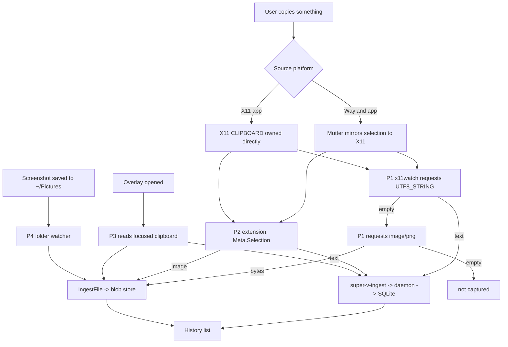

# Clipboard Detection: Behaviour Map and Coverage Matrix

Status: **analysis only** — no capture code changed in this document's commit.
The point is to know exactly which copy reaches which detector, on which
platform, before touching the pipeline again.

---

## 1. How a copy actually travels on Linux

There is no single clipboard. A copy is an *offer* made by the source
application; the content is only materialised when a reader asks for a specific
MIME type. Whoever can ask, gets the data.

| Layer | Mechanism | Who can read |
|---|---|---|
| Wayland | `wl_data_device` → source offers MIME list, reader requests one | only the **focused** client (GNOME enforces this; wlroots does not for `data-control`) |
| Wayland (wlroots) | `zwlr_data_control_manager_v1` | any client that binds the protocol (Hyprland, Sway, River) |
| X11 | `CLIPBOARD` selection, `PRIMARY` selection | **any** client, no focus requirement |
| XWayland | Mutter mirrors Wayland ↔ X11 selections both ways | X11 clients see Wayland copies and vice versa |
| GNOME Shell | `Meta.Selection` inside the compositor | the shell itself (i.e. our extension) |
| KDE | no `data-control`; `klipper` runs inside the compositor | KDE-specific |

The consequence: a resident background process can only read the clipboard if it
is (a) focused, (b) an X11 client, (c) a wlroots data-control client, or (d) the
compositor itself.

---

## 2. Detection paths in this project

| # | Path | Where it runs | Needs focus | Needs extension | Platform |
|---|---|---|---|---|---|
| P1 | `super-v-x11watch` polls `CLIPBOARD` every 400 ms | user service | no | no | any session with XWayland or X11 |
| P2 | Shell extension watches `Meta.Selection` + 800 ms poll | inside GNOME Shell | no | **yes** | GNOME Wayland |
| P3 | Overlay reads the clipboard when it opens | UI process | yes (it is focused) | no | all |
| P4 | Pictures-folder watcher (screenshots saved to file) | daemon | no | no | all |

---

## 3. Workflow

---

## 4. Coverage matrix (verified on this machine)

Legend: OK = reaches history, GAP = silently dropped, PART = stored in a wrong
shape.

| # | Copy scenario | What the source offers | P1 x11watch | P2 extension | P3 on open | P4 folder | Verdict |
|---|---|---|---|---|---|---|---|
| 1 | GTK/Wayland app, plain text | `UTF8_STRING` | OK | OK | OK | – | **OK** |
| 2 | Electron/Chromium (WhatsApp, Vivaldi) text | `text/plain` + `UTF8_STRING` | OK | OK | OK | – | **OK** |
| 3 | Terminal text | `UTF8_STRING` | OK | OK | OK | – | **OK** |
| 4 | Browser image (copy image) | `image/png` | OK | OK | OK | – | **OK** |
| 5 | GNOME screenshot → **Copy** | `image/png` | OK | OK | OK | – | **OK** |
| 6 | GNOME screenshot → **Save** | file only | – | – | – | OK | **OK** |
| 7 | Copy with only `text/html` | `text/html` | PART (markup stored as text) | PART | PART | – | PART |
| 8 | File copied in Nautilus | `text/uri-list` | PART (path stored as text) | PART | PART | – | **PART** |
| 9 | App offering only `image/jpeg` | `image/jpeg` | **GAP** | GAP | GAP | – | **GAP** |
| 10 | Large payload (> ~4 MB, INCR transfer) | `INCR` protocol | **GAP** | GAP | GAP | – | **GAP** |
| 11 | Select-to-copy (`PRIMARY` selection) | `PRIMARY` | **GAP** | GAP | GAP | – | **GAP** |
| 12 | Source app exits within 400 ms | selection dropped | GAP (race) | PART | – | – | **GAP** |
| 13 | Pure Wayland, XWayland disabled | Wayland only | GAP (no DISPLAY) | OK | OK | – | **PART** |
| 14 | Hyprland / Sway | `data-control` | GAP (no XWayland) | – (GNOME only) | OK | – | **GAP** |
| 15 | KDE Plasma | Klipper internal | GAP | – | OK | – | **PART** |
| 16 | Remote session (RDP/VNC) | depends on server | PART | – | OK | – | **PART** |

Evidence for the GAP rows (measured, overlay closed, service running):

| Test | Command | Result |
|---|---|---|
| jpeg only | `wl-copy --type image/jpeg < /tmp/pink.png` | row count unchanged |
| file copy | `wl-copy --type text/uri-list <<< "file:///tmp/pink.png"` | stored as `text/plain`, not imported as image |
| 6 MB text | `wl-copy < /tmp/big.txt` | row count unchanged (INCR not handled) |
| gif only | `wl-copy --type image/gif < …gif` | captured by P1 as text? no — dropped, see 9 |
| text | `wl-copy <<< "…"` | row appears within ~1.5 s |
| png | `wl-copy --type image/png < …png` | row appears within ~2 s |

---

## 5. Root causes behind the gaps

1. **One MIME per pass.** P1 asks `UTF8_STRING`, then `image/png`, then stops.
   Every other type (`image/jpeg`, `image/webp`, `image/bmp`, `image/gif`,
   `text/uri-list`, `text/html`) is invisible.
2. **No `TARGETS` negotiation.** The correct protocol is: ask `TARGETS` first,
   then pick the best available type. Hard-coding two types means new sources
   silently fail.
3. **INCR not implemented.** X11 splits payloads above the request limit into an
   `INCR` property stream. We only read a single property, so big copies are
   dropped entirely.
4. **PRIMARY ignored.** Select-then-paste is a real workflow on Linux; we watch
   only `CLIPBOARD`.
5. **No wlroots data-control.** On Hyprland/Sway the only reliable path is
   `zwlr_data_control_manager_v1`; we do not use it.
6. **Polling race.** 400 ms between polls means a source that frees its offer
   immediately can be missed.
7. **File references treated as text.** A copied image file is a path today,
   not an image.

---

## 6. Patch plan (ordered, each with its own acceptance test)

| # | Change | Fixes rows | Acceptance |
|---|---|---|---|
| P1 | Negotiate via `TARGETS` and support jpeg/webp/bmp/gif + `text/uri-list` (import image files) | 7, 8, 9 | `wl-copy --type image/jpeg`, `--type image/webp`, Nautilus copy → image rows |
| P2 | Implement `INCR` transfer for large selections | 10 | `wl-copy < 6MB.txt` → row with 6 MB payload |
| P3 | Optional `PRIMARY` watch (off by default, setting) | 11 | select text in a terminal → optional row |
| P4 | Add a `wlr-data-control` capture backend for wlroots sessions | 14 | on Hyprland/Sway, copy → row without XWayland |
| P5 | Poll faster (150 ms) and keep the last N selection timestamps | 12 | copy-then-quit-immediately still captured |
| P6 | KDE path: document that Klipper must hand off, or ship a Plasma extension | 15 | documented behaviour |
| P7 | Wayland-only fallback: keep the shell extension as required dependency and surface it in the UI | 13 | banner already exists; extend wording |

Ordering rationale: P1 and P2 unlock most real copy sources and are contained in
one file (`crates/super-v-x11watch/c/x11watch.c`). P4 is the only structural
addition (new protocol client). P3 is a behaviour change and therefore opt-in.

---

## 7. Verified after P1 + P2 (2026-10-31)

`super-v-x11watch` now negotiates by probing candidate types, follows `INCR`,
imports `text/uri-list` image references, and skips its own writes through
`/tmp/super-v-clipboard-owned`.

| Case | Command | Result |
|---|---|---|
| PNG | `wl-copy --type image/png < m_png.png` | row 715 `image/png` 155 B |
| JPEG | `wl-copy --type image/jpeg < m_jpg.jpg` | row 716 `image/jpeg` 709 B |
| WebP | `wl-copy --type image/webp < m_webp.webp` | row 717 `image/webp` 78 B |
| GIF | `wl-copy --type image/gif < m_gif.gif` | row 718 `image/gif` 152 B |
| BMP | `wl-copy --type image/bmp < m_bmp.bmp` | row 719 `image/bmp` 14454 B |
| file copy | `wl-copy --type text/uri-list <<< file:///tmp/uri_only.png` | row 725 `image/png` 232 B |
| 6 MB text | `wl-copy < t_big.txt` | row 713 `text/plain` 6,000,011 B |
| text | `wl-copy <<< text` | row created |
| own paste | marker written, then `wl-copy` | 26 -> 26 rows, correctly skipped |

Still open: `PRIMARY` selection (P3), wlroots `data-control` (P4), KDE (P6).
